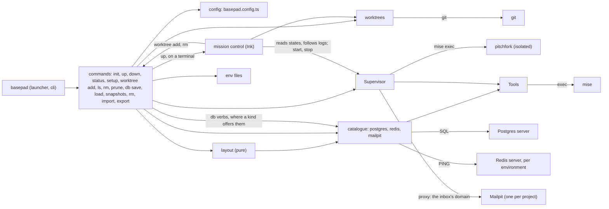

# Feature map

Start every task here: find the feature, open its paths, then read the code. The code is the truth; this map only says where to look.

A feature is anything a user starts from: an import, a config key, a command or a URL. Code with no entry point of its own belongs to the feature it serves.

- Words: [GLOSSARY.md](../GLOSSARY.md). Decisions: [docs/adr/](adr/). Commands: `AGENTS.md`.
- Change this file when a feature is added, removed, renamed or moved, or its purpose or entry point changes. `npm run check` runs `scripts/check-feature-map.ts`, which checks every entry and that every module under `src/` is claimed.

## Who calls whom

## Config

### The config file

Purpose: one committed, typed `basepad.config.ts` that names the project, its services (with each one's `worktree` option: copy, empty or shared), apps (each served at a domain, or with `port: false` for one that listens on nothing, or `domain: false` for one served at `https://localhost:$PORT`), env files and `worktrees` (prefix, folder, clone, setup); `basepad.config.local.ts` adjusts it per machine.
Entry: `import { defineConfig, postgres } from "basepad"`
Paths: src/index.ts, src/config.ts
Decisions: [0001](adr/0001-config-is-the-only-interface.md)

## Commands

### The `basepad` command

Purpose: runs basepad on mise's Node 24 whatever the project's Node, checks the mise floor, and dispatches commands and help from one table.
Entry: `basepad`, `basepad <command> --help`
Paths: src/launcher.ts, src/cli.ts, src/versions.ts, src/internal/exec.ts, src/internal/table.ts

### `basepad init`

Purpose: writes a starter config named from the folder, ignores the local file, adds basepad as a devDependency.
Entry: `basepad init`
Paths: src/init.ts

### `basepad up`, `down` and `status`

Purpose: runs each app under basepad's own pitchfork at `https://<app>.<name>.localhost`, starts services, sets the env keys the config names; stops them (on a terminal, the landing in `src/mission-control/launch.ts` shows them coming down); shows their state.
Entry: `basepad up [-d] [--claim]`, `basepad down`, `basepad status`
Paths: src/commands.ts, src/layout.ts, src/supervisor.ts, src/tools.ts, src/env-files.ts, src/internal/ports.ts, src/internal/processes.ts, src/mission-control/launch.ts, src/tls.ts
Decisions: [0001](adr/0001-config-is-the-only-interface.md)

### Mission control

Purpose: one place to see and steer a project while it runs, so nothing needs another command. It opens at once, while `up` readies the environment, so its logs show from the start; a failure shows as a notice. Then every environment (main and each worktree) at a glance, the selected one's apps and services with their addresses, and their logs live, with crashes standing out. Its keys are in `docs/guide.md`. It only reads and asks: the supervisor runs everything, and worktrees are added and removed by the `worktree add` and `worktree rm` commands in processes of their own (`work.ts`), so closing or crashing the view stops nothing. A pure frame (state to Ink element) and a pure reducer (key to view and intent), behind one feed (git, configs, the supervisor's states and `pitchfork logs --tail`, worktree work under way), one place that performs intents (`act.ts`) and one terminal adapter.
Entry: `basepad up` on a terminal (`-d`, or no terminal, skips it)
Paths: src/mission-control/, src/supervisor.ts, src/commands.ts, src/worktrees.ts

### `basepad worktree add`

Purpose: makes a worktree of main, ready to use: a git worktree with suffix `<prefix>-<n>`, beside the project, on a new branch or `--branch`'s, with `worktrees.clone` copied from main, its own databases (copied from main's while its app is connected, by the fastest route the server has; empty or shared), domains `<app>.<suffix>.<name>.localhost`, env files from main's, and `worktrees.setup` run in it. Its apps start on the first request to their domains (the supervisor's proxy, with main's services as dependencies), or at once with `--start`. `up`, `down` and `status` in its folder act on it; `up` in a git worktree made by hand makes it a worktree whose suffix is its folder's name. Worktrees are found from git; nothing is listed.
Entry: `basepad worktree add [--json] [--branch <name>] [--start]`, `basepad up` in a git worktree, `worktrees` in the config, `postgres({ worktree })`
Paths: src/worktrees.ts, src/commands.ts, src/layout.ts, src/catalogue/postgres.ts

### `basepad worktree ls`, `worktree rm` and `prune`

Purpose: lists worktrees (and `status` in main shows each); removes one from its suffix alone (apps, registration, databases, git worktree; branch kept; refuses uncommitted changes unless `--force`); clears what worktrees whose folder is gone left, and asks before deleting a removed service's data. Never drops main's databases.
Entry: `basepad worktree ls`, `basepad worktree rm <worktree> [--force]`, `basepad prune [--yes]`, `basepad status` in main
Paths: src/commands.ts, src/worktrees.ts, src/catalogue.ts, src/catalogue/postgres.ts, src/supervisor.ts, src/hosts.ts

### Claude Code's worktree hooks

Purpose: Claude Code's `WorktreeCreate` and `WorktreeRemove` hooks go through basepad, so every agent session gets a full worktree: `worktree add --claude` reads the hook input, uses its name as the branch and prints only the path; `worktree rm --claude` removes the worktree at its path, as `--force` does.
Entry: `basepad worktree add --claude`, `basepad worktree rm --claude`
Paths: src/claude-hooks.ts, src/commands.ts

### `basepad db save`, `load`, `snapshots`, `rm`, `import` and `export`

Purpose: snapshots of the database of the environment the command runs in (a worktree's, never main's, from inside one): save one by label (`default` when none), load it back while the app runs, list them with their size, delete one. A snapshot is a database `<database>@<label>` on the same server, found by name with no list kept, made by the Worktrees copy routine; a worktree's go with it on `worktree rm` and `prune`. The verbs are the Catalogue's optional `database` capability on a kind, so commands pick the service (`--service`, implied with one database) and the kind does the rest. `import` replaces the database with a dump file (custom format or plain SQL, told by its first bytes) or a `postgres://` URL's database, after asking with its name (`--yes` answers); each of `load`, `save` over a label and `import` makes the new database at `<database>~new` and swaps it in only once it is whole, so one that fails changes nothing. `export` writes a custom-format dump, plain SQL for a `.sql` name, or the dump to standard output with nothing else there.
Entry: `basepad db save [label]`, `basepad db load [label]`, `basepad db snapshots`, `basepad db rm <label>`, `basepad db import <file or url> [--yes]`, `basepad db export [file]`, each with `--service <key>`
Paths: src/commands.ts, src/catalogue.ts, src/catalogue/postgres.ts

### `basepad setup`

Purpose: one-time machine setup: trusts basepad's CA, and on Linux makes URLs port-free; adds domains to `/etc/hosts` where `*.localhost` doesn't resolve. On a terminal, its plan is a checklist beside a rocket on its pad (`launch.ts`), which lifts off once URLs are port-free.
Entry: `basepad setup [--dry-run] [--yes]`
Paths: src/setup.ts, src/hosts.ts, src/mission-control/launch.ts

### Port 443 on macOS

Purpose: port-free URLs on macOS with no privilege and no pf (pf turns off iCloud Private Relay): `serve` starts a forwarder on the wildcard address's port 443 that passes connections from this Mac to the proxy, refuses the network's, and stops with the supervisor. Off when `BASEPAD_PROXY_PORT` is set, or something else answers on 443.
Entry: `basepad up` on macOS
Paths: src/forward.ts, src/supervisor.ts, src/layout.ts

### Port 443 on macOS

Purpose: port-free URLs on macOS with no privilege and no pf (pf turns off iCloud Private Relay): `serve` starts a forwarder on the wildcard address's port 443 that passes connections from this Mac to the proxy, refuses the network's, and stops with the supervisor. Off when `BASEPAD_PROXY_PORT` is set, or something else answers on 443.
Entry: `basepad up` on macOS
Paths: src/forward.ts, src/supervisor.ts, src/layout.ts

## Services

### Postgres

Purpose: a Postgres 17 or 18 server per project, with its database stamped to the owning checkout, pgvector available, and connection values for `env`.
Entry: `services: { db: postgres({ version }) }` in the config
Paths: src/catalogue.ts, src/catalogue/postgres.ts, src/internal/service-user.ts

### Redis

Purpose: a Redis per environment, in memory, on a port derived from the environment's name (the next free one when taken, and env files follow), with `url`, `host` and `port` for `env`. A worktree's is its own and empty, started only with the worktree (`up`, `--start` or the first request to its apps), stopped by its `down` and removed by `worktree rm`; `worktree: "shared"` gives it main's.
Entry: `services: { cache: redis({ worktree }) }` in the config
Paths: src/catalogue.ts, src/catalogue/redis.ts, src/layout.ts

### Mailpit

Purpose: one Mailpit per project that catches all its mail, shared by its worktrees: the inbox at `https://<key>.<name>.localhost` (the Catalogue's `web`: a service asking Layout for a domain, which the supervisor's proxy serves), SMTP `url`, `host`, `port` and `user` for `env`, each environment's mail tagged by its SMTP user (`main` or the suffix).
Entry: `services: { mail: mailpit() }` in the config
Paths: src/catalogue.ts, src/catalogue/mailpit.ts, src/layout.ts
