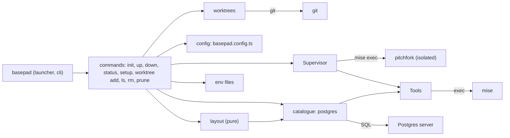

# Feature map

Start every task here: find the feature, open its paths, then read the code. The code is the truth; this map only says where to look.

A feature is anything a user starts from: an import, a config key, a command or a URL. Code with no entry point of its own belongs to the feature it serves.

- Words: [GLOSSARY.md](../GLOSSARY.md). Decisions: [docs/adr/](adr/). Commands: `AGENTS.md`.
- Change this file when a feature is added, removed, renamed or moved, or its purpose or entry point changes. `npm run check` runs `scripts/check-feature-map.ts`, which checks every entry and that every module under `src/` is claimed.

## Who calls whom

## Config

### The config file

Purpose: one committed, typed `basepad.config.ts` that names the project, its services (with each one's `worktree` option: copy, empty or shared), apps, env files and `worktrees` (prefix, folder, clone, setup); `basepad.config.local.ts` adjusts it per machine.
Entry: `import { defineConfig, postgres } from "@aysnc-labs/basepad"`
Paths: src/index.ts, src/config.ts
Decisions: [0001](adr/0001-config-is-the-only-interface.md)

## Commands

### The `basepad` command

Purpose: runs basepad on mise's Node 24 whatever the project's Node, checks the mise floor, and dispatches commands and help from one table.
Entry: `basepad`, `basepad <command> --help`
Paths: src/launcher.ts, src/cli.ts, src/versions.ts, src/internal/exec.ts, src/internal/table.ts

### `basepad init`

Purpose: writes a starter config named from the folder, ignores the local file, adds basepad as a devDependency.
Entry: `basepad init`
Paths: src/init.ts

### `basepad up`, `down` and `status`

Purpose: runs each app under basepad's own pitchfork at `https://<app>.<name>.localhost`, starts services, sets the env keys the config names; stops them; shows their state.
Entry: `basepad up [-d] [--claim]`, `basepad down`, `basepad status`
Paths: src/commands.ts, src/layout.ts, src/supervisor.ts, src/tools.ts, src/env-files.ts, src/internal/ports.ts
Decisions: [0001](adr/0001-config-is-the-only-interface.md)

### `basepad worktree add`

Purpose: makes a worktree of main, ready to use: a git worktree with suffix `<prefix>-<n>`, beside the project, on a new branch or `--branch`'s, with `worktrees.clone` copied from main, its own databases (copied from main's while its app is connected, by the fastest route the server has; empty or shared), domains `<app>.<suffix>.<name>.localhost`, env files from main's, and `worktrees.setup` run in it. Its apps start on the first request to their domains (the supervisor's proxy, with main's services as dependencies), or at once with `--start`. `up`, `down` and `status` in its folder act on it; `up` in a git worktree made by hand makes it a worktree whose suffix is its folder's name. Worktrees are found from git; nothing is listed.
Entry: `basepad worktree add [--json] [--branch <name>] [--start]`, `basepad up` in a git worktree, `worktrees` in the config, `postgres({ worktree })`
Paths: src/worktrees.ts, src/commands.ts, src/layout.ts, src/catalogue/postgres.ts

### `basepad worktree ls`, `worktree rm` and `prune`

Purpose: lists worktrees (and `status` in main shows each); removes one from its suffix alone (apps, registration, databases, git worktree; branch kept; refuses uncommitted changes unless `--force`); clears what worktrees whose folder is gone left, and asks before deleting a removed service's data. Never drops main's databases.
Entry: `basepad worktree ls`, `basepad worktree rm <worktree> [--force]`, `basepad prune [--yes]`, `basepad status` in main
Paths: src/commands.ts, src/worktrees.ts, src/catalogue.ts, src/catalogue/postgres.ts, src/supervisor.ts, src/hosts.ts

### Claude Code's worktree hooks

Purpose: Claude Code's `WorktreeCreate` and `WorktreeRemove` hooks go through basepad, so every agent session gets a full worktree: `worktree add --claude` reads the hook input, uses its name as the branch and prints only the path; `worktree rm --claude` removes the worktree at its path, as `--force` does.
Entry: `basepad worktree add --claude`, `basepad worktree rm --claude`
Paths: src/claude-hooks.ts, src/commands.ts

### `basepad setup`

Purpose: one-time machine setup: trusts basepad's CA and makes URLs port-free; adds domains to `/etc/hosts` where `*.localhost` doesn't resolve.
Entry: `basepad setup [--dry-run] [--yes]`
Paths: src/setup.ts, src/hosts.ts

## Services

### Postgres

Purpose: a Postgres 17 or 18 server per project, with its database stamped to the owning checkout, pgvector available, and connection values for `env`.
Entry: `services: { db: postgres({ version }) }` in the config
Paths: src/catalogue.ts, src/catalogue/postgres.ts, src/internal/service-user.ts
